<!-- Gerado por scripts/build.mjs a partir de data/. Edite data/ e scripts/, não este arquivo. -->
<h1 align="center"><picture><source media="(prefers-color-scheme: dark)" srcset="https://raw.githubusercontent.com/gabrielscr/gabrielscr/main/assets/hero-dark.svg"><source media="(prefers-color-scheme: light)" srcset="https://raw.githubusercontent.com/gabrielscr/gabrielscr/main/assets/hero-light.svg"></picture></h1>

<b>Gabriel Rocha</b> · fundador da <a href="https://grochatech.com.br"><b>GROCHA Tech</b></a> 
Desenvolvedor full-stack sênior · do conceito ao lançamento

<picture><source media="(prefers-color-scheme: dark)" srcset="https://raw.githubusercontent.com/gabrielscr/gabrielscr/main/assets/tile-contrib-dark.svg"><source media="(prefers-color-scheme: light)" srcset="https://raw.githubusercontent.com/gabrielscr/gabrielscr/main/assets/tile-contrib-light.svg">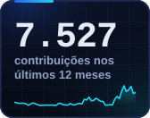</picture>
<picture><source media="(prefers-color-scheme: dark)" srcset="https://raw.githubusercontent.com/gabrielscr/gabrielscr/main/assets/tile-repos-dark.svg"><source media="(prefers-color-scheme: light)" srcset="https://raw.githubusercontent.com/gabrielscr/gabrielscr/main/assets/tile-repos-light.svg">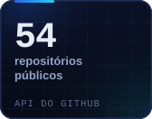</picture>
<picture><source media="(prefers-color-scheme: dark)" srcset="https://raw.githubusercontent.com/gabrielscr/gabrielscr/main/assets/tile-produtos-dark.svg"><source media="(prefers-color-scheme: light)" srcset="https://raw.githubusercontent.com/gabrielscr/gabrielscr/main/assets/tile-produtos-light.svg">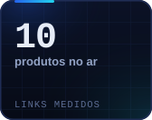</picture>
<picture><source media="(prefers-color-scheme: dark)" srcset="https://raw.githubusercontent.com/gabrielscr/gabrielscr/main/assets/tile-jogos-dark.svg"><source media="(prefers-color-scheme: light)" srcset="https://raw.githubusercontent.com/gabrielscr/gabrielscr/main/assets/tile-jogos-light.svg">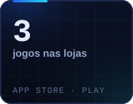</picture>

<picture><source media="(prefers-color-scheme: dark)" srcset="https://raw.githubusercontent.com/gabrielscr/gabrielscr/main/assets/skyline-dark.svg"><source media="(prefers-color-scheme: light)" srcset="https://raw.githubusercontent.com/gabrielscr/gabrielscr/main/assets/skyline-light.svg"></picture>

<h2 align="center"><picture><source media="(prefers-color-scheme: dark)" srcset="https://raw.githubusercontent.com/gabrielscr/gabrielscr/main/assets/section-jogos-dark.svg"><source media="(prefers-color-scheme: light)" srcset="https://raw.githubusercontent.com/gabrielscr/gabrielscr/main/assets/section-jogos-light.svg"></picture></h2>

<a href="https://play.google.com/store/apps/details?id=com.gabrielrocha.cilada"><picture><source media="(prefers-color-scheme: dark)" srcset="https://raw.githubusercontent.com/gabrielscr/gabrielscr/main/assets/card-cilada-dark.svg"><source media="(prefers-color-scheme: light)" srcset="https://raw.githubusercontent.com/gabrielscr/gabrielscr/main/assets/card-cilada-light.svg"></picture></a>
<a href="https://cilada-3d.web.app/"><picture><source media="(prefers-color-scheme: dark)" srcset="https://raw.githubusercontent.com/gabrielscr/gabrielscr/main/assets/card-cilada-3d-dark.svg"><source media="(prefers-color-scheme: light)" srcset="https://raw.githubusercontent.com/gabrielscr/gabrielscr/main/assets/card-cilada-3d-light.svg"></picture></a>
<a href="https://play.google.com/store/apps/details?id=com.grochatech.panteao"><picture><source media="(prefers-color-scheme: dark)" srcset="https://raw.githubusercontent.com/gabrielscr/gabrielscr/main/assets/card-panteao-dark.svg"><source media="(prefers-color-scheme: light)" srcset="https://raw.githubusercontent.com/gabrielscr/gabrielscr/main/assets/card-panteao-light.svg"></picture></a>
<picture><source media="(prefers-color-scheme: dark)" srcset="https://raw.githubusercontent.com/gabrielscr/gabrielscr/main/assets/card-runavald-dark.svg"><source media="(prefers-color-scheme: light)" srcset="https://raw.githubusercontent.com/gabrielscr/gabrielscr/main/assets/card-runavald-light.svg">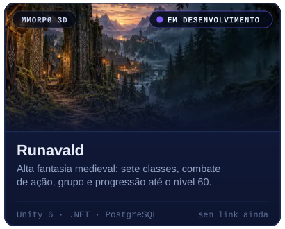</picture>
<picture><source media="(prefers-color-scheme: dark)" srcset="https://raw.githubusercontent.com/gabrielscr/gabrielscr/main/assets/card-gabrio-dark.svg"><source media="(prefers-color-scheme: light)" srcset="https://raw.githubusercontent.com/gabrielscr/gabrielscr/main/assets/card-gabrio-light.svg">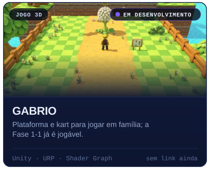</picture>
<picture><source media="(prefers-color-scheme: dark)" srcset="https://raw.githubusercontent.com/gabrielscr/gabrielscr/main/assets/card-worlds-together-dark.svg"><source media="(prefers-color-scheme: light)" srcset="https://raw.githubusercontent.com/gabrielscr/gabrielscr/main/assets/card-worlds-together-light.svg">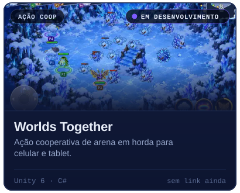</picture>
<picture><source media="(prefers-color-scheme: dark)" srcset="https://raw.githubusercontent.com/gabrielscr/gabrielscr/main/assets/card-pipo-dark.svg"><source media="(prefers-color-scheme: light)" srcset="https://raw.githubusercontent.com/gabrielscr/gabrielscr/main/assets/card-pipo-light.svg">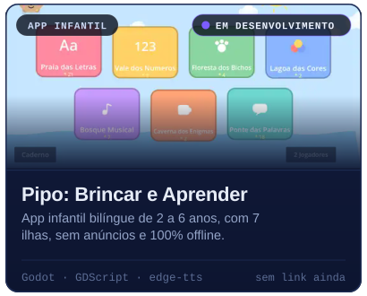</picture>

<h2 align="center"><picture><source media="(prefers-color-scheme: dark)" srcset="https://raw.githubusercontent.com/gabrielscr/gabrielscr/main/assets/section-saas-dark.svg"><source media="(prefers-color-scheme: light)" srcset="https://raw.githubusercontent.com/gabrielscr/gabrielscr/main/assets/section-saas-light.svg"></picture></h2>

<a href="https://www.tempestivo.com.br"><picture><source media="(prefers-color-scheme: dark)" srcset="https://raw.githubusercontent.com/gabrielscr/gabrielscr/main/assets/card-tempestivo-dark.svg"><source media="(prefers-color-scheme: light)" srcset="https://raw.githubusercontent.com/gabrielscr/gabrielscr/main/assets/card-tempestivo-light.svg"></picture></a>
<a href="https://revamd.com.br"><picture><source media="(prefers-color-scheme: dark)" srcset="https://raw.githubusercontent.com/gabrielscr/gabrielscr/main/assets/card-revamed-dark.svg"><source media="(prefers-color-scheme: light)" srcset="https://raw.githubusercontent.com/gabrielscr/gabrielscr/main/assets/card-revamed-light.svg"></picture></a>
<a href="https://contabil.grochatech.com.br"><picture><source media="(prefers-color-scheme: dark)" srcset="https://raw.githubusercontent.com/gabrielscr/gabrielscr/main/assets/card-gr-contabil-dark.svg"><source media="(prefers-color-scheme: light)" srcset="https://raw.githubusercontent.com/gabrielscr/gabrielscr/main/assets/card-gr-contabil-light.svg"></picture></a>
<a href="https://mob.grochatech.com.br"><picture><source media="(prefers-color-scheme: dark)" srcset="https://raw.githubusercontent.com/gabrielscr/gabrielscr/main/assets/card-gr-mob-dark.svg"><source media="(prefers-color-scheme: light)" srcset="https://raw.githubusercontent.com/gabrielscr/gabrielscr/main/assets/card-gr-mob-light.svg"></picture></a>
<a href="https://poker.grochatech.com.br"><picture><source media="(prefers-color-scheme: dark)" srcset="https://raw.githubusercontent.com/gabrielscr/gabrielscr/main/assets/card-gr-poker-dark.svg"><source media="(prefers-color-scheme: light)" srcset="https://raw.githubusercontent.com/gabrielscr/gabrielscr/main/assets/card-gr-poker-light.svg"></picture></a>
<a href="https://builder.grochatech.com.br"><picture><source media="(prefers-color-scheme: dark)" srcset="https://raw.githubusercontent.com/gabrielscr/gabrielscr/main/assets/card-gr-builder-dark.svg"><source media="(prefers-color-scheme: light)" srcset="https://raw.githubusercontent.com/gabrielscr/gabrielscr/main/assets/card-gr-builder-light.svg"></picture></a>
<picture><source media="(prefers-color-scheme: dark)" srcset="https://raw.githubusercontent.com/gabrielscr/gabrielscr/main/assets/card-grerp-dark.svg"><source media="(prefers-color-scheme: light)" srcset="https://raw.githubusercontent.com/gabrielscr/gabrielscr/main/assets/card-grerp-light.svg">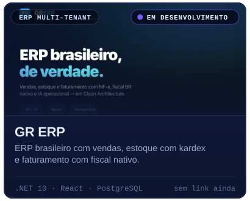</picture>
<a href="https://figurino.shop"><picture><source media="(prefers-color-scheme: dark)" srcset="https://raw.githubusercontent.com/gabrielscr/gabrielscr/main/assets/card-figurino-dark.svg"><source media="(prefers-color-scheme: light)" srcset="https://raw.githubusercontent.com/gabrielscr/gabrielscr/main/assets/card-figurino-light.svg"></picture></a>

<h2 align="center"><picture><source media="(prefers-color-scheme: dark)" srcset="https://raw.githubusercontent.com/gabrielscr/gabrielscr/main/assets/section-apps-dark.svg"><source media="(prefers-color-scheme: light)" srcset="https://raw.githubusercontent.com/gabrielscr/gabrielscr/main/assets/section-apps-light.svg"></picture></h2>

<a href="https://financas.grochatech.com.br/"><picture><source media="(prefers-color-scheme: dark)" srcset="https://raw.githubusercontent.com/gabrielscr/gabrielscr/main/assets/card-gr-financas-dark.svg"><source media="(prefers-color-scheme: light)" srcset="https://raw.githubusercontent.com/gabrielscr/gabrielscr/main/assets/card-gr-financas-light.svg"></picture></a>
<a href="https://www.stopaposta.com.br"><picture><source media="(prefers-color-scheme: dark)" srcset="https://raw.githubusercontent.com/gabrielscr/gabrielscr/main/assets/card-stopaposta-dark.svg"><source media="(prefers-color-scheme: light)" srcset="https://raw.githubusercontent.com/gabrielscr/gabrielscr/main/assets/card-stopaposta-light.svg"></picture></a>
<a href="https://play.google.com/store/apps/details?id=br.com.aprendeai.app"><picture><source media="(prefers-color-scheme: dark)" srcset="https://raw.githubusercontent.com/gabrielscr/gabrielscr/main/assets/card-tiradez-dark.svg"><source media="(prefers-color-scheme: light)" srcset="https://raw.githubusercontent.com/gabrielscr/gabrielscr/main/assets/card-tiradez-light.svg"></picture></a>
<a href="https://www.uplevfit.com"><picture><source media="(prefers-color-scheme: dark)" srcset="https://raw.githubusercontent.com/gabrielscr/gabrielscr/main/assets/card-uplevfit-dark.svg"><source media="(prefers-color-scheme: light)" srcset="https://raw.githubusercontent.com/gabrielscr/gabrielscr/main/assets/card-uplevfit-light.svg">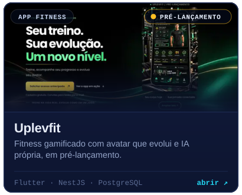</picture></a>
<picture><source media="(prefers-color-scheme: dark)" srcset="https://raw.githubusercontent.com/gabrielscr/gabrielscr/main/assets/card-avus-dark.svg"><source media="(prefers-color-scheme: light)" srcset="https://raw.githubusercontent.com/gabrielscr/gabrielscr/main/assets/card-avus-light.svg">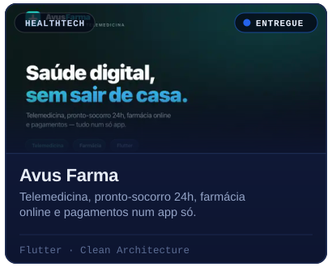</picture>
<picture><source media="(prefers-color-scheme: dark)" srcset="https://raw.githubusercontent.com/gabrielscr/gabrielscr/main/assets/card-bradesco-dark.svg"><source media="(prefers-color-scheme: light)" srcset="https://raw.githubusercontent.com/gabrielscr/gabrielscr/main/assets/card-bradesco-light.svg"></picture>
<picture><source media="(prefers-color-scheme: dark)" srcset="https://raw.githubusercontent.com/gabrielscr/gabrielscr/main/assets/card-dmconta-dark.svg"><source media="(prefers-color-scheme: light)" srcset="https://raw.githubusercontent.com/gabrielscr/gabrielscr/main/assets/card-dmconta-light.svg">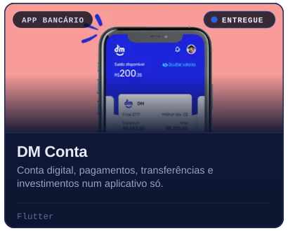</picture>

<h2 align="center"><picture><source media="(prefers-color-scheme: dark)" srcset="https://raw.githubusercontent.com/gabrielscr/gabrielscr/main/assets/section-ia-dark.svg"><source media="(prefers-color-scheme: light)" srcset="https://raw.githubusercontent.com/gabrielscr/gabrielscr/main/assets/section-ia-light.svg"></picture></h2>

<picture><source media="(prefers-color-scheme: dark)" srcset="https://raw.githubusercontent.com/gabrielscr/gabrielscr/main/assets/card-grocha-ia-dark.svg"><source media="(prefers-color-scheme: light)" srcset="https://raw.githubusercontent.com/gabrielscr/gabrielscr/main/assets/card-grocha-ia-light.svg">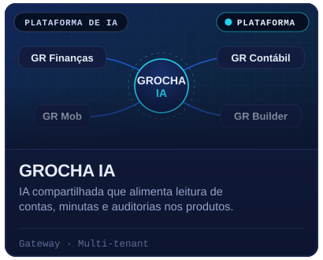</picture>

<h2 align="center"><picture><source media="(prefers-color-scheme: dark)" srcset="https://raw.githubusercontent.com/gabrielscr/gabrielscr/main/assets/section-clientes-dark.svg"><source media="(prefers-color-scheme: light)" srcset="https://raw.githubusercontent.com/gabrielscr/gabrielscr/main/assets/section-clientes-light.svg"></picture></h2>

<a href="https://escritoriorichardmartins.com"><picture><source media="(prefers-color-scheme: dark)" srcset="https://raw.githubusercontent.com/gabrielscr/gabrielscr/main/assets/card-richard-dark.svg"><source media="(prefers-color-scheme: light)" srcset="https://raw.githubusercontent.com/gabrielscr/gabrielscr/main/assets/card-richard-light.svg"></picture></a>
<a href="https://dr-elson-shockness.web.app"><picture><source media="(prefers-color-scheme: dark)" srcset="https://raw.githubusercontent.com/gabrielscr/gabrielscr/main/assets/card-dr-elson-dark.svg"><source media="(prefers-color-scheme: light)" srcset="https://raw.githubusercontent.com/gabrielscr/gabrielscr/main/assets/card-dr-elson-light.svg"></picture></a>
<a href="https://rochacontabilidade.digital"><picture><source media="(prefers-color-scheme: dark)" srcset="https://raw.githubusercontent.com/gabrielscr/gabrielscr/main/assets/card-rocha-dark.svg"><source media="(prefers-color-scheme: light)" srcset="https://raw.githubusercontent.com/gabrielscr/gabrielscr/main/assets/card-rocha-light.svg"></picture></a>
<a href="https://www.drbrenomendes.com.br"><picture><source media="(prefers-color-scheme: dark)" srcset="https://raw.githubusercontent.com/gabrielscr/gabrielscr/main/assets/card-breno-mendes-dark.svg"><source media="(prefers-color-scheme: light)" srcset="https://raw.githubusercontent.com/gabrielscr/gabrielscr/main/assets/card-breno-mendes-light.svg"></picture></a>
<picture><source media="(prefers-color-scheme: dark)" srcset="https://raw.githubusercontent.com/gabrielscr/gabrielscr/main/assets/card-bruna-dark.svg"><source media="(prefers-color-scheme: light)" srcset="https://raw.githubusercontent.com/gabrielscr/gabrielscr/main/assets/card-bruna-light.svg"></picture>

<h2 align="center"><picture><source media="(prefers-color-scheme: dark)" srcset="https://raw.githubusercontent.com/gabrielscr/gabrielscr/main/assets/section-oss-dark.svg"><source media="(prefers-color-scheme: light)" srcset="https://raw.githubusercontent.com/gabrielscr/gabrielscr/main/assets/section-oss-light.svg"></picture></h2>

<a href="https://github.com/gabrielscr/signalr_ultra"><picture><source media="(prefers-color-scheme: dark)" srcset="https://raw.githubusercontent.com/gabrielscr/gabrielscr/main/assets/card-signalr_ultra-dark.svg"><source media="(prefers-color-scheme: light)" srcset="https://raw.githubusercontent.com/gabrielscr/gabrielscr/main/assets/card-signalr_ultra-light.svg">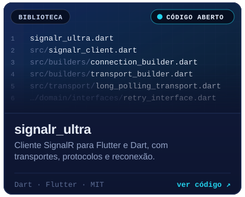</picture></a>
<a href="https://github.com/gabrielscr/code-agents"><picture><source media="(prefers-color-scheme: dark)" srcset="https://raw.githubusercontent.com/gabrielscr/gabrielscr/main/assets/card-code-agents-dark.svg"><source media="(prefers-color-scheme: light)" srcset="https://raw.githubusercontent.com/gabrielscr/gabrielscr/main/assets/card-code-agents-light.svg">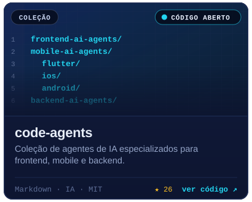</picture></a>
<a href="https://github.com/gabrielscr/media_social_share"><picture><source media="(prefers-color-scheme: dark)" srcset="https://raw.githubusercontent.com/gabrielscr/gabrielscr/main/assets/card-media_social_share-dark.svg"><source media="(prefers-color-scheme: light)" srcset="https://raw.githubusercontent.com/gabrielscr/gabrielscr/main/assets/card-media_social_share-light.svg">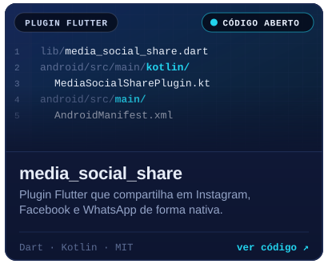</picture></a>
<a href="https://github.com/gabrielscr/orders_sw"><picture><source media="(prefers-color-scheme: dark)" srcset="https://raw.githubusercontent.com/gabrielscr/gabrielscr/main/assets/card-orders_sw-dark.svg"><source media="(prefers-color-scheme: light)" srcset="https://raw.githubusercontent.com/gabrielscr/gabrielscr/main/assets/card-orders_sw-light.svg">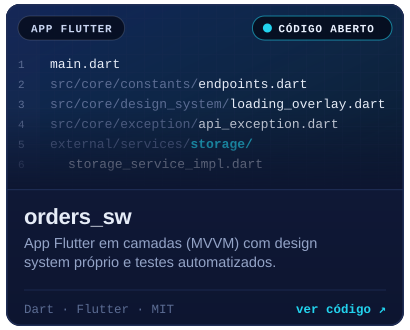</picture></a>

<h2 align="center"><picture><source media="(prefers-color-scheme: dark)" srcset="https://raw.githubusercontent.com/gabrielscr/gabrielscr/main/assets/footer-dark.svg"><source media="(prefers-color-scheme: light)" srcset="https://raw.githubusercontent.com/gabrielscr/gabrielscr/main/assets/footer-light.svg">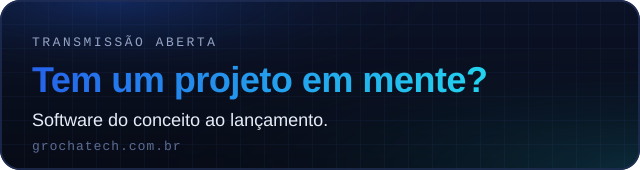</picture></h2>

<a href="https://grochatech.com.br"><picture><source media="(prefers-color-scheme: dark)" srcset="https://raw.githubusercontent.com/gabrielscr/gabrielscr/main/assets/btn-site-dark.svg"><source media="(prefers-color-scheme: light)" srcset="https://raw.githubusercontent.com/gabrielscr/gabrielscr/main/assets/btn-site-light.svg"></picture></a>
<a href="https://eu.grochatech.com.br"><picture><source media="(prefers-color-scheme: dark)" srcset="https://raw.githubusercontent.com/gabrielscr/gabrielscr/main/assets/btn-portfolio-dark.svg"><source media="(prefers-color-scheme: light)" srcset="https://raw.githubusercontent.com/gabrielscr/gabrielscr/main/assets/btn-portfolio-light.svg"></picture></a>
<a href="https://wa.me/5519996115213"><picture><source media="(prefers-color-scheme: dark)" srcset="https://raw.githubusercontent.com/gabrielscr/gabrielscr/main/assets/btn-whatsapp-dark.svg"><source media="(prefers-color-scheme: light)" srcset="https://raw.githubusercontent.com/gabrielscr/gabrielscr/main/assets/btn-whatsapp-light.svg">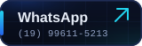</picture></a>
<a href="https://linkedin.com/in/gabrielscr"><picture><source media="(prefers-color-scheme: dark)" srcset="https://raw.githubusercontent.com/gabrielscr/gabrielscr/main/assets/btn-linkedin-dark.svg"><source media="(prefers-color-scheme: light)" srcset="https://raw.githubusercontent.com/gabrielscr/gabrielscr/main/assets/btn-linkedin-light.svg"></picture></a>

<h2 align="center">Linha do tempo</h2>

<picture><source media="(prefers-color-scheme: dark)" srcset="https://raw.githubusercontent.com/gabrielscr/gabrielscr/main/assets/timeline-dark.svg"><source media="(prefers-color-scheme: light)" srcset="https://raw.githubusercontent.com/gabrielscr/gabrielscr/main/assets/timeline-light.svg">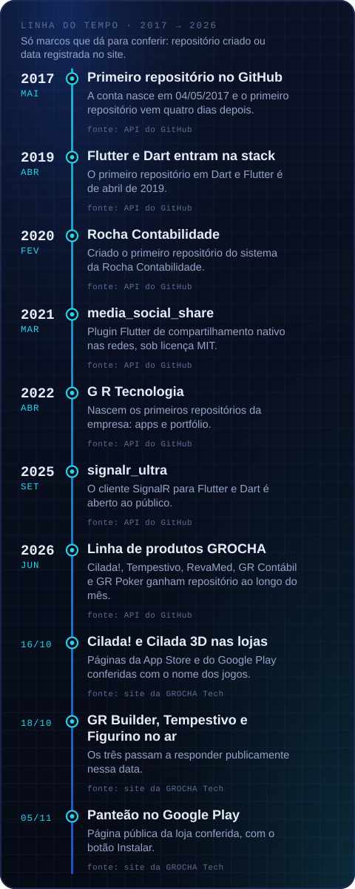</picture>

<h2 align="center">Stack</h2>

<picture><source media="(prefers-color-scheme: dark)" srcset="https://raw.githubusercontent.com/gabrielscr/gabrielscr/main/assets/stack-backend-e-dados-dark.svg"><source media="(prefers-color-scheme: light)" srcset="https://raw.githubusercontent.com/gabrielscr/gabrielscr/main/assets/stack-backend-e-dados-light.svg">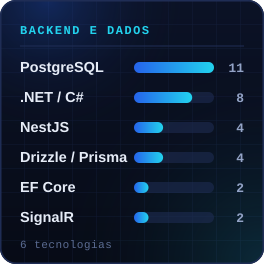</picture>
<picture><source media="(prefers-color-scheme: dark)" srcset="https://raw.githubusercontent.com/gabrielscr/gabrielscr/main/assets/stack-mobile-dark.svg"><source media="(prefers-color-scheme: light)" srcset="https://raw.githubusercontent.com/gabrielscr/gabrielscr/main/assets/stack-mobile-light.svg">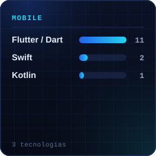</picture>
<picture><source media="(prefers-color-scheme: dark)" srcset="https://raw.githubusercontent.com/gabrielscr/gabrielscr/main/assets/stack-web-dark.svg"><source media="(prefers-color-scheme: light)" srcset="https://raw.githubusercontent.com/gabrielscr/gabrielscr/main/assets/stack-web-light.svg">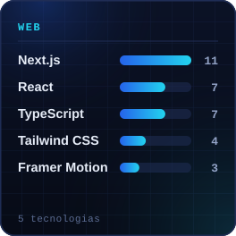</picture>
<picture><source media="(prefers-color-scheme: dark)" srcset="https://raw.githubusercontent.com/gabrielscr/gabrielscr/main/assets/stack-jogos-dark.svg"><source media="(prefers-color-scheme: light)" srcset="https://raw.githubusercontent.com/gabrielscr/gabrielscr/main/assets/stack-jogos-light.svg">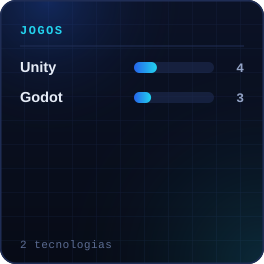</picture>
<picture><source media="(prefers-color-scheme: dark)" srcset="https://raw.githubusercontent.com/gabrielscr/gabrielscr/main/assets/stack-nuvem-e-entrega-dark.svg"><source media="(prefers-color-scheme: light)" srcset="https://raw.githubusercontent.com/gabrielscr/gabrielscr/main/assets/stack-nuvem-e-entrega-light.svg">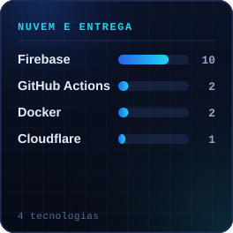</picture>
<picture><source media="(prefers-color-scheme: dark)" srcset="https://raw.githubusercontent.com/gabrielscr/gabrielscr/main/assets/stack-ia-e-pagamentos-dark.svg"><source media="(prefers-color-scheme: light)" srcset="https://raw.githubusercontent.com/gabrielscr/gabrielscr/main/assets/stack-ia-e-pagamentos-light.svg">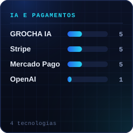</picture>

<b>Tudo em texto</b> (lista de projetos, links e contatos)

 

**Jogos**

| Projeto | Tipo | Estado | Link |
|---|---|---|---|
| Cilada! | Jogo 2d | Nas lojas | [play.google.com/store/apps/details?id=com.gabrielrocha.cilada](https://play.google.com/store/apps/details?id=com.gabrielrocha.cilada) |
| Cilada 3D | Jogo 3d | Nas lojas | [cilada-3d.web.app](https://cilada-3d.web.app/) |
| Panteão: Batalha de Cards | Jogo de cartas | Nas lojas | [play.google.com/store/apps/details?id=com.grochatech.panteao](https://play.google.com/store/apps/details?id=com.grochatech.panteao) |
| Runavald | Mmorpg 3d | Em desenvolvimento | — |
| GABRIO | Jogo 3d | Em desenvolvimento | — |
| Worlds Together | Ação coop | Em desenvolvimento | — |
| Pipo: Brincar e Aprender | App infantil | Em desenvolvimento | — |

**Produtos SaaS**

| Projeto | Tipo | Estado | Link |
|---|---|---|---|
| Tempestivo | Saas jurídico | No ar | [www.tempestivo.com.br](https://www.tempestivo.com.br) |
| RevaMed | Saas de ensino | No ar | [revamd.com.br](https://revamd.com.br) |
| GR Contábil | Saas contábil | No ar | [contabil.grochatech.com.br](https://contabil.grochatech.com.br) |
| GR Mob | Plataforma white-label | No ar | [mob.grochatech.com.br](https://mob.grochatech.com.br) |
| GR Poker | Tempo real | No ar | [poker.grochatech.com.br](https://poker.grochatech.com.br) |
| GR Builder | Construtor de sites | No ar | [builder.grochatech.com.br](https://builder.grochatech.com.br) |
| GR ERP | Erp multi-tenant | Em desenvolvimento | — |
| Figurino | Moda customizável | No ar | [figurino.shop](https://figurino.shop) |

**Apps**

| Projeto | Tipo | Estado | Link |
|---|---|---|---|
| GR Finanças | App financeiro | No ar | [financas.grochatech.com.br](https://financas.grochatech.com.br/) |
| StopAposta | App de saúde | No ar | [www.stopaposta.com.br](https://www.stopaposta.com.br) |
| TiraDez | App de ensino | Nas lojas | [play.google.com/store/apps/details?id=br.com.aprendeai.app](https://play.google.com/store/apps/details?id=br.com.aprendeai.app) |
| Uplevfit | App fitness | Pré-lançamento | [www.uplevfit.com](https://www.uplevfit.com) |
| Avus Farma | Healthtech | Entregue | — |
| Bradesco Shop | E-commerce | Entregue | — |
| DM Conta | App bancário | Entregue | — |

**IA e plataforma**

| Projeto | Tipo | Estado | Link |
|---|---|---|---|
| GROCHA IA | Plataforma de ia | Plataforma | — |

**Sites de clientes**

| Projeto | Tipo | Estado | Link |
|---|---|---|---|
| Dr. Richard Martins | Site + blog | No ar | [escritoriorichardmartins.com](https://escritoriorichardmartins.com) |
| Dr. Elson Shockness | Site médico | No ar | [dr-elson-shockness.web.app](https://dr-elson-shockness.web.app) |
| Rocha Contabilidade Digital | Site + painel | No ar | [rochacontabilidade.digital](https://rochacontabilidade.digital) |
| Dr. Breno Mendes | Site de campanha | No ar | [www.drbrenomendes.com.br](https://www.drbrenomendes.com.br) |
| Dra. Bruna Rocha | Site pwa | Fora do ar | — |

**Open source**

| Projeto | Tipo | Estado | Link |
|---|---|---|---|
| signalr_ultra | Biblioteca | Código aberto | [github.com/gabrielscr/signalr_ultra](https://github.com/gabrielscr/signalr_ultra) |
| code-agents | Coleção | Código aberto | [github.com/gabrielscr/code-agents](https://github.com/gabrielscr/code-agents) |
| media_social_share | Plugin flutter | Código aberto | [github.com/gabrielscr/media_social_share](https://github.com/gabrielscr/media_social_share) |
| orders_sw | App flutter | Código aberto | [github.com/gabrielscr/orders_sw](https://github.com/gabrielscr/orders_sw) |

**Contato:** [grochatech.com.br](https://grochatech.com.br) · [eu.grochatech.com.br](https://eu.grochatech.com.br) · [WhatsApp (19) 99611-5213](https://wa.me/5519996115213) · [LinkedIn](https://linkedin.com/in/gabrielscr)

Painel gerado por <a href="https://github.com/gabrielscr/gabrielscr/tree/main/scripts">scripts/</a> a partir de <code>data/projects.json</code>. Contribuições, repositórios e o LED de cada link são medidos todo dia pelo GitHub Actions; o link só aparece onde o endereço é público.

